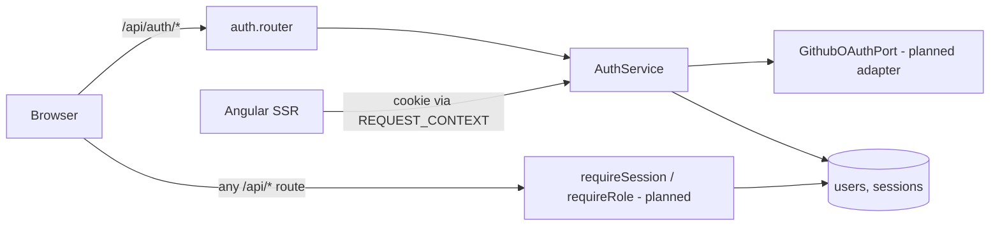

# Accounts and roles — sign-in with GitHub, email fallback, role-scoped screens

Source: epic E01 (#11) — stories E01-S01 (#17), E01-S02 (#18), E01-S03 (#19) · Design authority: `.ai/specs/product-brief.md` (R06, R07, D07, D19, D13, N01, N02)

## 📝 TLDR

DevMentor has no accounts today: the shell serves a demo task list and an unprotected `/admin` page, and nothing identifies a visitor. This spec proposes (future behavior) one session and role model shared by three stories: sign-in with GitHub for every role (#17, first to implement), email plus password as the fallback (#18), and server-enforced role-scoped screens with an operator role reserved for the two founders (#19). One spec covers all three because they share the user table, the session cookie and the guards; they ship as three phases, each independently releasable.

## 📝 Problem Statement

Every later epic needs to know who is acting and in which role: mentors publish slots (E02), mentees book and pay (E03), the operator invites and resolves disputes (E05). Without a trustworthy identity and role, none of those can be built, and mentor-only or operator-only data cannot be protected. The brief fixes the product answers — GitHub for every role with email plus password as fallback (R06/D07), mentors only by invitation (R07), operator = the two founders (D19). It does not evidence that sign-in friction matters; this spec carries no claim about conversion.

## 📝 Proposed Solution

- **Identity.** One `users` table; a user has a single `role` (`mentee` | `mentor` | `operator`) and one or both sign-in identities (a GitHub numeric id, or an email plus password hash).
- **GitHub sign-in.** Server-side OAuth authorization-code flow in Express, behind a `GithubOAuthPort` adapter (the only file that talks to GitHub). First GitHub sign-in creates a `mentee` — never a `mentor` (R07; the invitation upgrade path is E02-S01).
- **Email fallback.** `register` (mentee only) and `sign-in` with email plus password hashed with argon2id. Generic failure message.
- **Sessions.** Opaque random session id in an `httpOnly` cookie; only its SHA-256 hash is stored in `sessions`. This is a deliberate, declared deviation from the standard's "signed (HS256) token" wording: an opaque server-side session needs no signing secret and satisfies the standard's intent (short expiry, `httpOnly`/`Secure`/`SameSite` cookie, nothing in `localStorage`). The implementing Phase 1 PR amends `.ai/docs/engineering-standards.md` (Sessions row and "Still open" list) so the standard and the code agree. Role is read from the database on every request, so a role change takes effect immediately and every check fails closed. The **effective role** is computed in one place (the session resolver behind `requireSession`, `GET /api/auth/session` and SSR): a user whose stored role is `operator` is effective `operator` only while their `github_id` is in `OPERATOR_GITHUB_IDS`, otherwise effective `mentee`.
- **Role-scoped screens.** Server `requireSession` / `requireRole` on every non-public route, mirrored by functional Angular route guards (UX only, never the control). Each role has a minimal home screen; `/home` resolves to it.
- **Operator.** Granted only by an environment allowlist of founder GitHub ids, applied at GitHub sign-in. No route, payload or UI can assign it.
- **Alternatives considered.** (1) Signed JWT cookie — rejected: role changes and sign-out cannot take effect before expiry without a denylist. (2) Auth library (Passport/better-auth) — rejected for the first iteration: one provider plus one password flow is smaller than the library's surface and keeps the SSR/`REQUEST_CONTEXT` wiring explicit; revisit if a third provider appears. (3) GitHub-only, no email — rejected: contradicts R06.

## 📝 Architecture

Existing: Express app in `src/server.ts`, repositories passed through `REQUEST_CONTEXT`, `TasksApi` with `Server*`/`Http*` pair and `TransferState`, `UnauthorizedError`/`ForbiddenError` already in `server/http/errors.ts`, single `apiErrorHandler`. New (all planned, no existing consumer): concept folder `auth` in each layer — `server/auth/`, `core/api/` session model and `SessionApi`, `store/session/`, `features/auth/`.

Takeaway: authorization lives in one server middleware pair; the Angular guards only decide which screen to show. SSR resolves the session from the request cookie directly (no HTTP loopback) and hands the browser a sanitized `{ id, role, displayName } | null` via `TransferState`.

Dependencies on future work: E02-S01 (#20) adds invitations and the mentee→mentor upgrade; E05 adds operator screens. This spec defines the extension points (role enum, `requireRole`) and nothing else for them.

## 📝 Data Model

`users` (table `users`, `EntitySchema` `User` in `server/auth/user.entity.ts`, record type in `user.model.ts`):

| column | type | notes |
| --- | --- | --- |
| `id` | uuid PK | generated server-side |
| `role` | varchar(16) not null | `mentee` \| `mentor` \| `operator`; default `mentee` |
| `display_name` | varchar(120) not null | GitHub name/login, or the email local-part on registration |
| `github_id` | bigint null, unique | immutable GitHub numeric id (not the renameable login) |
| `email` | varchar(254) null, unique | stored lower-cased; null for GitHub-only users |
| `password_hash` | varchar null | argon2id encoded hash; null for GitHub-only users |
| `created_at` | timestamptz not null | |

Check: at least one of `github_id` or (`email` and `password_hash`) is present. No account linking between a GitHub user and an email user in 1.0 (see assumptions).

`sessions` (`session.entity.ts`): `id_hash` char(64) PK (SHA-256 of the cookie value), `user_id` FK → `users` on delete cascade, `created_at`, `expires_at`. Index on `user_id` and `expires_at`.

Sensitive data: password hashes and session hashes never leave the server, never enter `TransferState`, responses or logs. GitHub access tokens are used once in the callback to read the profile and are **not stored**. No GitHub email is requested in 1.0 (scope `read:user` only).

Schema is additive (two new tables); bootstrap stays `schema.update()` per the current standard. `BACKWARD_COMPATIBILITY.md` §1–2 must list the new routes and tables, and §4 the new required environment variables (below), in the implementing PR. Existing `/api/tasks` contracts do not change. Required variables are a breaking change for every existing deployment and sandbox: the implementing PR documents them in the README, and Phase 1 lists them in the PR body's rollout note (the app refuses to start without them).

## 📝 API Contracts

All under `/api/auth`, JSON, errors through the shared envelope `{ message, code?, fieldErrors? }`. State-changing routes require the custom CSRF header `X-Requested-With: devmentor` (set by a shared client request helper that does not exist yet and is created in Phase 1 step 6; the existing `HttpTasksApi` and `/api/tasks` are not changed) plus `SameSite=Lax` cookie.

| Route | Request | Success | Failure |
| --- | --- | --- | --- |
| `GET /api/auth/github` | — | `302` to GitHub authorize URL; sets short-lived `oauth_state` cookie (random state plus the validated relative `returnTo`, if any; `httpOnly`, `Secure` in production, `SameSite=Lax` so it survives GitHub's top-level redirect back, `Path=/api/auth`, 10 min) | — (missing OAuth config fails startup, see Config) |
| `GET /api/auth/github/callback?code&state` | query | sets session cookie, clears `oauth_state`, `302` to the stored `returnTo` or `/home` | state mismatch, GitHub error, or `error=` param → `302` to `/sign-in?error=github` (no session) |
| `POST /api/auth/register` | `{ email, password, displayName }` | `201` + session cookie, user `{ id, role: 'mentee', displayName }` | `400` field errors (email format, password length 12–128, displayName 1–120); `409` generic "could not create account" when email exists; `429` after 5 attempts per IP in 15 min (register shares the limiter, keyed by IP) |
| `POST /api/auth/sign-in` | `{ email, password }` | `200` + session cookie, `{ id, role, displayName }` | `401` `"Invalid email or password"` for unknown email **and** wrong password (same body, comparable timing via a dummy hash verify); `429` after 5 failures per email+IP in 15 min (client IP = `req.ip`; the server sets Express `trust proxy` only to the configured hop count, never `true`) |
| `POST /api/auth/sign-out` | — | `204`, session row deleted, cookie cleared | idempotent `204` |
| `GET /api/auth/session` | — | `200` `{ user: { id, role, displayName } \| null }` | never `401` (public) |

Cookie `dm_session`: 32 random bytes base64url, `httpOnly`, `Secure` in production, `SameSite=Lax`, `Path=/`, 24 h idle expiry (refreshed on use) capped at 7 days absolute. Sessions are rotated on sign-in (any session presented with the request is deleted, a new id is issued). Expired rows are purged opportunistically on each sign-in (`delete where expires_at < now`) — no scheduler. Cookies are parsed by a small helper, not a new dependency.

Middleware (`server/http/auth.ts`): `requireSession(req)` → user or `UnauthorizedError`; `requireRole(req, ...roles)` → `ForbiddenError` otherwise; any error inside the check denies (fail closed). Role is loaded from the DB, never from the cookie.

Config (validated at startup, `.env` git-ignored): `GITHUB_CLIENT_ID`, `GITHUB_CLIENT_SECRET`, `APP_BASE_URL`, `OPERATOR_GITHUB_IDS` (comma-separated numeric ids), optional `GITHUB_OAUTH_BASE_URL` / `GITHUB_API_BASE_URL` (default github.com, overridable so integration tests run a local fake).

## 📝 UI/UX

Flows only; standard form chrome omitted.

- **`/sign-in`** (public): primary "Sign in with GitHub" button, secondary email+password form, link to "Create account with email" (mentee). States: idle, submitting, field errors, generic credential error, GitHub error banner ("GitHub sign-in did not complete. Try again.") — stays on the page. A signed-in visitor is redirected to `/home`.
- **`/home`**: resolves by role to **`/mentee`**, **`/mentor`**, **`/operator`** (the last two arrive in Phase 3) — each a minimal placeholder home (heading, signed-in name, sign-out). Later epics fill them.
- **Denied**: a signed-in user opening a route of another role sees a `403` "You do not have access to this page" screen; a signed-out visitor opening a protected route is sent to `/sign-in?returnTo=<route>` (relative paths only, validated). SSR returns the matching status codes.
- Accessibility: labelled inputs, errors associated with fields and announced, visible focus, GitHub button is a real link/button with text.
- The existing demo routes (`/` tasks, `/admin`) are untouched.
- Prototype: none. No test-environment descriptor exists, so no mockups or screenshots accompany this spec (text-only).

## 📝 Edge Cases & Failure Scenarios

- GitHub refuses or errors (user cancels, bad `code`, network failure, 5xx): no session, redirect to `/sign-in?error=github`, error logged without the code/token.
- OAuth `state` missing, mismatched or expired (10 min): treated as failure, never as sign-in.
- Same GitHub id signs in again: same user, display name refreshed, role untouched except the operator allowlist sync below.
- Operator allowlist: on GitHub sign-in, role becomes `operator` iff `github_id ∈ OPERATOR_GITHUB_IDS`; a founder removed from the list is demoted to `mentee` (stored) at their next sign-in **and** immediately for existing sessions, because the single effective-role computation (see Proposed Solution → Sessions) applies the allowlist on every request — so `requireRole`, `GET /api/auth/session`, `/home` and the Angular guards all agree, not only `requireRole('operator')`. A demotion discards any earlier role: a founder who was also an invited mentor must be re-invited by E02-S01 (accepted for 1.0). `github_id` is a `bigint`: the pg driver returns it as a string, so compare it with the parsed allowlist as strings (or `BigInt`), never as JS numbers. Unparsable allowlist → startup failure.
- Email already registered: registration returns the generic `409`; sign-in does not reveal existence (timing equalized). The `409` itself does confirm existence to anyone who registers — inherent without email verification (Q6), so enumeration is rate-limited (per IP) and recorded in Risks; the story's non-disclosure criterion covers sign-in only.
- Brute force: per email+IP limiter (in-process, no new dependency); lost on restart and not shared across instances — acceptable for one instance, recorded as a limit.
- Expired/unknown session cookie: treated as signed out, cookie cleared.
- Mentee requests a mentor-only API route: `403` JSON; the Angular guard is never the only barrier.
- SSR hydration: session in `TransferState` contains only `{ id, role, displayName }`.
- Concurrent first GitHub sign-ins for one id: unique constraint + upsert in a transaction; loser re-reads.
- GitHub profile with no `name`: falls back to login.
- Observability: sign-in success/failure, rate-limit hits and role changes (promote/demote) are logged as structured events carrying user id and reason only — never passwords, codes, tokens, cookie values or full emails.

## 📝 Risks & Impact Review

- **Hard to reverse:** the `users` shape (single role per user, one table for both identities) is the contract every later epic builds on; splitting identities into a separate table later needs a migration. Chosen deliberately small; role as an enum column avoids a join per request.
- **Auth is risk-high** (SDLC): the implementing PRs require the security checklist in `.ai/docs/engineering-standards.md` and regression tests for every negative acceptance criterion.
- **New dependency:** `argon2` (native). Build/CI image impact is unmeasured here; fallback allowed by the standard is bcrypt cost ≥ 12.
- **No email verification and no password reset in 1.0:** an email account can be created with someone else's address, registration confirms whether an email exists (`409`), and a forgotten password is recovered by the founders by hand (R18, shared operator note). Acceptable at invite-only supply scale; revisit with the first support case.
- **Existing `/api/tasks` and `/admin` demo routes remain unauthenticated**; they hold no product data and are slated for removal outside this spec.
- Product direction calls (invite-only, GitHub-first) are owned by founder A (R06, R07); nothing here supersedes an active decision.

## 📝 Decisions in play

- R06 / D07 — GitHub for every role, email plus password fallback (founder A) — implemented.
- R07 / D08 — mentors only by invitation (founder A) — this spec only guarantees GitHub/email sign-up yields `mentee`.
- D19 — operator is the two founders (both founders) — operator by allowlist, no self-assignment.
- D13 — E01-S01, S02, S03 are in the first iteration. Nothing superseded.

## Resolved assumptions (autonomous defaults)

| # | Question | Chosen answer | Rationale |
| --- | --- | --- | --- |
| Q1 | One spec or split per story? | One spec, three phases | The stories share user table, session and guards; none functions without S01 (cohesion test fails for splitting). |
| Q2 | Auth library or own flow? | Own flow behind `GithubOAuthPort`, no auth framework | Smallest surface, matches ports-and-adapters standard; reversible by swapping the adapter. |
| Q3 | Signed JWT or opaque DB session? | Opaque id cookie, hash stored in `sessions` | Immediate role change/sign-out; meets the standard's cookie rules. |
| Q4 | Password hashing | `argon2` (argon2id) | Mandated by the standard (argon2id or bcrypt ≥ 12); bcrypt is the stated fallback. ✅ Confirmed 2026-10-18 by the requester — adds a native dependency. |
| Q5 | How is the operator granted? | `OPERATOR_GITHUB_IDS` env allowlist of founder GitHub numeric ids, applied at GitHub sign-in and re-checked on every request through the effective-role computation; email accounts can never be operator | No assignable path in code (D19 AC); a database-managed grant would need an admin surface D19 explicitly avoids. ✅ Confirmed 2026-10-18 by the requester (config allowlist chosen over a database-managed grant) — the founders' GitHub ids must be supplied at deployment. |
| Q6 | Email registration for mentees, verification, reset | Registration yes (mentee only); email verification and password reset deferred; founders recover by hand | Smallest scope that satisfies "user without GitHub signs in" (#18, which defines sign-in but not creation); R18 covers manual operator work. ✅ Confirmed 2026-10-18 by the requester. |
| Q7 | Link GitHub and email accounts of one person? | No linking in 1.0; two identities are two users | Avoids account-takeover via unverified email; reversible later by a merge story. |
| Q8 | Role name for the developer who books | `mentee` | Matches the brief's glossary; #17's naming question is non-blocking. |
| Q9 | Where does each role land? | `/home` → `/mentee`, `/mentor`, `/operator` placeholders | Smallest surface that satisfies "lands in their role's home"; content arrives with E02–E05. |
| Q10 | Demo routes (`/`, `/admin`, `/api/tasks`) | Left as is | Out of scope; touching them widens the change. |
| Q11 | Rate limiting store | In-process map, 5 failures / 15 min per email+IP | No new infrastructure; single instance today; limit documented. |
| Q12 | Mentors before invitations exist (E02-S01) | No path to `mentor` in this spec; tests create mentors/operators via fixtures | Honors R07; the upgrade path belongs to #20. |

## 📋 Phasing

- **Phase 1 — E01-S01 (#17), implement first.** Schema, session core, GitHub sign-in, role homes, sign-out, session in SSR. Ships a working GitHub-only sign-in for mentees (the only role obtainable before Phase 3).
- **Phase 2 — E01-S02 (#18).** Email registration and sign-in on the same session core.
- **Phase 3 — E01-S03 (#19).** Server `requireRole`, Angular guards, 403/redirect behavior, operator allowlist.

Each phase leaves the app deployable; later phases do not change earlier contracts (only add routes and middleware use).

## 📋 Implementation Plan

Every step ships unit tests so the project stays at 100% coverage; every new route/page also gets an integration and an e2e happy path (AGENTS.md).

### Phase 1 — E01-S01 (#17): sign in with GitHub

1. **Contracts and config.** `core/api/session.model.ts` (`Role`, `SessionUser`), `server/auth/auth.model.ts`, startup config parsing/validation helper (`GITHUB_*`, `APP_BASE_URL`, `OPERATOR_GITHUB_IDS` parsed but unused until Phase 3). Test: config helper valid/invalid cases.
2. **Entities and repositories.** `User`, `Session` `EntitySchema`s; `UsersRepository`, `SessionsRepository` (fork `EntityManager` per call; upsert-by-`github_id` in a transaction). Register entities in `createOrm`. Test: repository specs against the existing test DB pattern.
3. **Session service and cookie helper.** Create/validate/rotate/delete sessions, hashing, cookie flags, expiry (24 h idle / 7 d absolute). Test: expiry, rotation, tampered cookie, fail-closed errors.
4. **`GithubOAuthPort` + adapter.** Authorize URL, code→token→`GET /user`; base URLs overridable. Test: adapter with a mocked `fetch` (success, 4xx, 5xx, missing id).
5. **Auth router (GitHub + session + sign-out).** `GET /api/auth/github`, `/callback`, `GET /session`, `POST /sign-out`; state cookie; CSRF-header check on `POST`; mount in `server.ts` before the `/api` error handler and behind the same `schemaReady` gate as `/api/tasks`; add to `ServerRequestContext`. Acceptance mapping: refused/error callback → `/sign-in?error=github`, no session (negative); new GitHub user → `mentee` (R07). Test: router specs for every branch.
6. **Client session plumbing.** `SessionApi` abstraction with `ServerSessionApi` (cookie via `REQUEST_CONTEXT`, `TransferState`) and `HttpSessionApi`; `store/session/` slice (actions, reducer, selectors, effects); shared request helper adds the CSRF header. Test: API, effects, reducer, selectors.
7. **Screens.** `features/auth/` sign-in page (GitHub button, error banner) and `/home` + the `/mentee` placeholder home with its view-model service (`/home` falls back to `/mentee`; `/mentor` and `/operator` homes are added in Phase 3 together with their guards; `/home` and `/mentee` ship in Phase 1 behind a minimal signed-in guard — signed-out → `/sign-in?returnTo=` — so no role screen ever ships unprotected; Phase 3 adds the per-role guards and the 403 screen); signed-in visitors redirected from `/sign-in`. Test: component/view-model specs.
8. **Integration + e2e.** Fake GitHub server via `GITHUB_OAUTH_BASE_URL`; happy path (sign in → mentee home), refused callback stays on sign-in, redirect of signed-in visitor. Update `BACKWARD_COMPATIBILITY.md`.

### Phase 2 — E01-S02 (#18): email and password

1. **Password service.** argon2id hash/verify (parameters per standard), dummy-hash verify for unknown email, input parsing helper (`parseRegisterBody`, `parseSignInBody`). Test: hashing never logs/returns plaintext; length bounds.
2. **Routes.** `POST /register` (mentee), `POST /sign-in`, in-process limiter (sign-in per email+IP, register per IP; `trust proxy` configured via an env hop count), generic `401`/`409`; both routes enforce the CSRF header like every state-changing route. Test: wrong password and unknown email return identical status/body (negative AC); 429 after limit on both routes; stored hash is not the password.
3. **UI.** Email form and registration form on `/sign-in`, field errors, generic credential error. Test: component specs.
4. **Integration + e2e.** Register → home; wrong password message; sign-out.

### Phase 3 — E01-S03 (#19): role-scoped screens

1. **Server enforcement.** (The Phase 1 session resolver is reused; this step adds the `requireSession`/`requireRole` middleware pair on top.) `server/http/auth.ts` `requireSession`/`requireRole` (fail closed); apply to a role-test route per role; the effective-role computation (allowlist re-check) lives in the session resolver so every consumer sees it. Test also: founder removed from the allowlist is denied on the next request with an old session. Test: mentee → `403` on mentor/operator routes, signed out → `401` (negative ACs).
2. **Operator grant.** Sync role from `OPERATOR_GITHUB_IDS` at GitHub sign-in (promote and demote); no API or payload can set `role`; registration and GitHub first sign-in ignore any role input. Test: founder promoted, non-founder never, email user never, removed founder demoted.
3. **Role homes and Angular guards.** Add the `/mentor` and `/operator` placeholder homes behind the guards; `/home` resolves all three roles. Functional `canMatch` guards per role reading the session view-model; signed-out → `/sign-in?returnTo=` (relative-path validation), wrong role → 403 screen with matching SSR status. Test: guard specs.
4. **Integration + e2e.** Mentee opening `/mentor` and `/operator` is denied; signed-out redirect with return path; operator reaches `/operator` only via allowlisted GitHub id.
