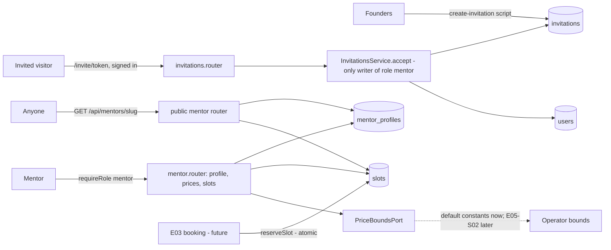

# Mentors become bookable — invitation, mentor page, slots, prices

Source: epic E02 (#12) — stories E02-S01 (#20), E02-S02 (#21), E02-S03 (#22), E02-S04 (#23) · Design authority: `.ai/specs/product-brief.md` (R04, R07, R08, R14, R16, D08, D09, D21, D22, D24, N01, N02) · Builds on: `.ai/specs/2026-10-18-auth-and-roles.md` (spec PR #46, E01 — unmerged when this spec was written; read from branch `spec/auth-and-roles`)

## 📝 TLDR

An invited senior engineer cannot become a mentor today: no account, role or invitation exists. This spec proposes (future behavior) the four steps that turn an invitation into a **bookable mentor**: accept a single-use invitation link and get the `mentor` role with no open registration (#20), fill a public mentor page with a share link and no ratings (#21), set 25- and 50-minute prices validated against operator bounds (#23), and publish slots that flip to "taken" when booked (#22). One spec covers all four because they share one concept — the mentor's *offer* (`mentor_profiles`, `slots`, `invitations`), one role gate (`requireRole('mentor')`) and one derived rule ("a slot is bookable only if the mentor has a page, valid prices, and the slot starts at least two hours ahead"). They ship as four independently releasable phases. Stripe Connect onboarding (E02-S05, #24/#39) and operator-set bounds (E05-S02, #36) are separate work and appear only as dependencies.

## 📝 Problem Statement

1.0 has no supply until invited seniors can become bookable (A03, accepted untested by D18; the check is "at least one bookable session within two weeks of accepting", R17). Mentees cannot book (E03) and the list/share link (E03-S01) cannot exist until a mentor has a page, prices and slots. The brief fixes the product answers: invitation only (R07/D08), a link to public work and a plain description with no ratings (R04/N02), tags only from four (R16/D24), mentor-set prices within operator bounds (R08/D09), slots bookable at least two hours ahead (R14/D22). The brief does **not** decide the slot shape or how the mentor learns of a booking (explicit open question in #22 and the brief); this spec writes the plain reading of D22 and records both as assumptions. No claim is made here about how many invited mentors will accept or publish — that is exactly what D18's check measures.

## 📝 Proposed Solution

- **Invitation (#20).** The founders create single-use invitations out of band (a server script, until the operator story E05-S01 exists). An invitation is a 256-bit random token in a link `/invite/<token>`; only its SHA-256 hash is stored. A **signed-in** user opening a valid link sees an explicit "Accept and become a mentor" action; accepting consumes the invitation and promotes that user from `mentee` to `mentor` atomically. Expired, used or unknown links all show the same "This invitation link is no longer valid" page (negative AC). No other code path can write `role = 'mentor'` (R07).
- **Mentor page (#21).** One public page per mentor at `/m/<slug>` (the share link): display name, a required public-work link, a required plain description, 1–4 stack tags from the fixed list `TypeScript | React | Python | AI agents`. No rating or review data exists anywhere in schema, API or UI (R04/N02). The page loads without sign-in.
- **Prices (#23).** Two prices (25 and 50 minutes) in whole units of one platform currency. A save is accepted only inside the operator's bounds; otherwise `400` with the bounds. Bounds come from a `PriceBoundsPort`; until E05-S02 ships, a constant default implements it.
- **Slots (#22).** A slot is a single published start time (no recurrence, no duration — the mentee picks 25 or 50 minutes at booking, E03-S02). Statuses `open` → `booked`. Booking flips the status through one atomic repository operation that this spec ships and E03 calls; the mentor sees "Booked" on the slots screen.
- **Derived "bookable".** `bookable(slot) = mentor page published ∧ both prices set and inside current bounds ∧ slot.status = 'open' ∧ slot.starts_at ≥ now + 2 h`. A mentor with no price therefore has no bookable slots (R08). Computed at read time by one pure helper; never stored.
- **Alternatives considered.** (1) Invitations bound to the invitee's email — rejected for 1.0: the founders invite through Twitter/LinkedIn/conference contacts and may not hold the email the senior signs in with, and #46 does not verify email; recorded as an assumption with its risk. (2) Recurring weekly hours — rejected: the brief leaves the shape open, recurring hours need a generator, time-zone/DST rules and exception handling, none of which D22 asks for; single start times are the smallest reading and can be extended additively later. (3) Store a `bookable` flag on slots — rejected: it goes stale whenever bounds, prices or time change. (4) One spec per story — rejected: the stories share tables, the role gate and the bookable rule; splitting would duplicate the same contracts four times (cohesion).

## 📝 Architecture

Existing: Express app in `apps/shell/src/server.ts`, repositories via `REQUEST_CONTEXT`, `UnauthorizedError`/`ForbiddenError` in `server/http/errors.ts`, one `apiErrorHandler`, the `TasksApi` `Server*`/`Http*` pair with `TransferState`, MikroORM `EntitySchema` entities with `schema.update()` bootstrap (`server/database`).

Planned by #46 and consumed here (not yet in the repository): `users` (`id`, `role`, `display_name`, …), `sessions`, `requireSession`, `requireRole(req, ...roles)` in `server/http/auth.ts`, the CSRF header `X-Requested-With: devmentor` on state-changing routes, `UsersRepository`, `/sign-in?returnTo=` with relative-path validation, `/mentor` placeholder home behind the `mentor` guard, the `Role` enum, and the explicit extension point "E02-S01 adds invitations and the mentee→mentor upgrade". This spec adds exactly that and nothing else to the auth concept.

New server concept folders (all planned): `server/invitations/`, `server/mentors/` (profile, pricing, public page), `server/slots/`. New client: `features/mentor/` (home, profile, pricing, slots), `features/mentor-public/` (`/m/:slug`), `features/invitation/` (`/invite/:token`), `core/api/` `MentorApi`/`InvitationApi` with `Server*`/`Http*` pairs.

Takeaway: the invitation service is the single writer of the `mentor` role; the mentor routes sit behind `requireRole('mentor')` (server is the control, Angular guards are UX); the public page is a separate router with an explicit allowlist serializer so private fields can never leak.

### Dependencies on other work

- **#46 (E01) — required.** Phase 1 below needs #46 Phase 1 (users, sessions, GitHub sign-in, `requireSession`); Phases 2–4 need #46 Phase 3 (`requireRole`, mentor home behind a guard, `returnTo`). Implementation order: #46 Phases 1 and 3, then this spec. If #46's contracts change before merge, this spec follows them (role enum, `requireRole` signature, error envelope).
- **E02-S05 Stripe Connect onboarding (#24, T01 #39) — out of scope, separate sibling spec, 1.1 (D13).** This spec neither requires nor checks payout readiness; bookability here does not depend on Connect. Whether a mentor may be *booked* before Connect is complete is E02-S05/E03-S03's decision, not made here.
- **E05-S02 (#36) operator price bounds — out of scope.** This spec defines only how a mentor's prices are validated against bounds (see Prices below) and the port E05-S02 implements. **E05-S01 (#35)** (invite UI) is likewise out; the script here is its stand-in.
- **E03-S01 (#25) mentor list, E03-S02 (#26) booking, E03-S04 (#28) booking notifications** consume `published_at`, `reserveSlot` and the bookable helper defined here; they are out of scope.

## 📝 Data Model

All entities use `EntitySchema`, types in `*.model.ts`, repositories fork the `EntityManager` per call. Schema change is additive (three tables) via the existing `schema.update()` bootstrap; no change to `users` (the role value `mentor` already exists in #46's enum).

`invitations` (`server/invitations/invitation.entity.ts`):

| column | type | notes |
| --- | --- | --- |
| `id` | uuid PK | |
| `token_hash` | char(64) not null, unique | SHA-256 hex of the link token; the token itself is never stored or logged |
| `label` | varchar(120) not null | founders' note of whom it is for (e.g. "Jane — conference speaker"); never shown publicly |
| `batch` | varchar(40) null | free text such as `batch-1` (R17: batches of 20), for the founders' counting |
| `created_at` | timestamptz not null | |
| `expires_at` | timestamptz not null | default `created_at + 14 days` |
| `used_at` | timestamptz null | set on acceptance |
| `used_by_user_id` | uuid null FK → `users` | on delete set null |

`mentor_profiles` (`server/mentors/mentor-profile.entity.ts`), one row per mentor (`user_id` PK, FK → `users` on delete cascade):

| column | type | notes |
| --- | --- | --- |
| `slug` | varchar(60) not null, unique | immutable share-link segment, assigned on first creation: kebab-case of `display_name` (ASCII-folded, max 40) + `-` + 6 random base36 characters; collisions retried |
| `public_work_url` | varchar(2048) null | `https` URL; null until the page is first saved |
| `description` | varchar(1500) null | plain text; null until first save |
| `stack_tags` | text[] / jsonb not null default empty | subset of the four-tag enum |
| `price_25_minor` | integer null | minor units (cents) of the platform currency |
| `price_50_minor` | integer null | |
| `published_at` | timestamptz null | set when the page is first saved valid; the page is public iff not null |
| `created_at`, `updated_at` | timestamptz not null | |

A row is created at acceptance with null page fields and empty prices, so prices and page may be saved in either order. There is deliberately **no** rating, review, score, rank or count column here or anywhere else (R04/N02).

`slots` (`server/slots/slot.entity.ts`):

| column | type | notes |
| --- | --- | --- |
| `id` | uuid PK | |
| `mentor_id` | uuid not null FK → `users` on delete cascade | |
| `starts_at` | timestamptz not null | stored in UTC; whole 5-minute marks |
| `status` | varchar(8) not null | `open` \| `booked`; default `open` |
| `booked_at` | timestamptz null | set by `reserveSlot` |
| `booking_id` | uuid null | written by E03; **no FK** until the bookings table exists |
| `created_at` | timestamptz not null | `created_at` of the newest open slot is what E03-S01 orders the list by ("most recent published availability") |

Unique `(mentor_id, starts_at)`; index `(mentor_id, starts_at)` and `(status, starts_at)`.

Sensitive data: the token (bearer credential for a role grant) lives only in the founders' hands and the link; DB holds its hash; the accept route and the invitation page never echo it in logs or error bodies. The public serializer returns only `slug`, `displayName`, `publicWorkUrl`, `description`, `stackTags`, prices and bookable slot times — never `user_id`, email, GitHub id or invitation data.

Constants in `*.model.ts` (single source of truth): `STACK_TAGS = ['TypeScript','React','Python','AI agents'] as const` (`mentors/mentor.model.ts`), `SESSION_LENGTHS = [25, 50] as const`, `MIN_BOOKING_LEAD_MINUTES = 120` (R14/D22), `SLOT_GRID_MINUTES = 5`, `MAX_SLOT_HORIZON_DAYS = 90`, `MAX_OPEN_SLOTS_PER_MENTOR = 200`, `INVITATION_TTL_DAYS = 14`, `DEFAULT_PRICE_BOUNDS` and `PLATFORM_CURRENCY` (see Prices).

## 📝 API Contracts

JSON, errors through the shared envelope `{ message, code?, fieldErrors? }`. State-changing routes require the CSRF header from #46. Mentor routes: `requireRole(req, 'mentor')` first — signed out → `401`, mentee/operator → `403`, any error inside the check denies.

### Invitations (E02-S01)

| Route | Auth | Request | Success | Failure |
| --- | --- | --- | --- | --- |
| `GET /api/invitations/:token` | public | — | `200 { valid: true }` | `200 { valid: false }` for expired, used **and** unknown tokens (identical body, so a visitor cannot probe) |
| `POST /api/invitations/:token/accept` | `requireSession` | — (no body; the payload can carry no role) | `200 { user: { id, role: 'mentor', displayName }, profileSlug }` | `404 "This invitation link is no longer valid"` for expired/used/unknown (same body); `403` when the caller is an `operator`; `409 "You are already a mentor"` when the caller is already a mentor (the invitation is **not** consumed); signed out → `401` |

Accept is one transaction: `UPDATE invitations SET used_at = now(), used_by_user_id = :u WHERE token_hash = :h AND used_at IS NULL AND expires_at > now()` — affected rows must be exactly 1, otherwise `404` — then `UPDATE users SET role = 'mentor' WHERE id = :u AND role = 'mentee'` (affected rows must be 1, otherwise roll back → `409`/`403`), then insert the empty `mentor_profiles` row. Two concurrent accepts of one link: exactly one wins, the other gets `404`. `UsersRepository` exposes **only** `promoteToMentor(userId)` (called solely from `InvitationsService.accept`); there is no generic `setRole`, so no other route can create a mentor.

Operator tooling (not an HTTP route): `npm run invite -- --label "<text>" [--batch <name>] [--ttl-days N]` — a Node script under `apps/shell/src/server/invitations/` using the same repository; prints the full URL (`APP_BASE_URL/invite/<token>`) **once** and writes nothing else to stdout/logs. Per R18/D19 the founders log each invitation in the shared operator note. Requires direct database access, which the founders already hold.

### Mentor page and prices (E02-S02, E02-S04)

| Route | Auth | Request | Success | Failure |
| --- | --- | --- | --- | --- |
| `GET /api/mentor/profile` | mentor | — | `200 { slug, shareUrl, publicWorkUrl, description, stackTags, published }` (nulls before first save) | — |
| `PUT /api/mentor/profile` | mentor | `{ publicWorkUrl, description, stackTags }` | `200` as above; sets `published_at` on first valid save | `400` `fieldErrors`: `publicWorkUrl` required, `https` URL, no embedded credentials, ≤ 2048; `description` required, trimmed 20–1500 chars; `stackTags` 1–4 distinct values from `STACK_TAGS` (unknown value → `400`; any extra property such as `rating` is ignored and never stored) |
| `GET /api/mentor/pricing` | mentor | — | `200 { currency, bounds: { 25: { min, max }, 50: { min, max } }, prices: { 25: number\|null, 50: number\|null } }` in whole currency units | — |
| `PUT /api/mentor/pricing` | mentor | `{ price25, price50 }` (integers, whole units) | `200` as GET | `400` `fieldErrors` per price: not an integer, below min or above max — message names the bounds ("25-minute price must be between 15 and 150 EUR"); `price50 < price25` → error on `price50`. Nothing is stored when either price is invalid |
| `GET /api/mentors/:slug` | **public**, no session | — | `200 { slug, displayName, publicWorkUrl, description, stackTags, prices: { 25, 50 } \| null, slots: [{ id, startsAt }], currency }` — `prices` is null and `slots` empty when the mentor is not currently bookable; `slots` are the bookable ones only, ascending, capped at 50 | `404` for an unknown slug **and** for a mentor whose page is not yet published (same body) |

`PUT /api/mentor/profile` and `/pricing` are full replacements of their own field groups and never touch the other group. The public response is built by one allowlist serializer (`toPublicMentor`); a unit test asserts the exact key set, so a future `rating` field cannot appear by accident.

Price validation, the whole rule set: `bounds = await priceBoundsPort.getBounds()`; each price must be an integer number of whole units with `bounds[len].min ≤ price ≤ bounds[len].max`; `price50 ≥ price25`. Prices are stored as minor units (`× 100`). **Stale prices:** if the operator later changes bounds so that a stored price falls outside them, the stored value is kept but the mentor is treated as having no valid price (not bookable) until they re-save; `GET /api/mentor/pricing` flags this per price (`outOfBounds: true`).

### Slots (E02-S03)

| Route | Auth | Request | Success | Failure |
| --- | --- | --- | --- | --- |
| `GET /api/mentor/slots` | mentor | — | `200 { slots: [{ id, startsAt, status: 'open'\|'booked', bookable: boolean }] }` — upcoming only (`starts_at ≥ now`), ascending | — |
| `POST /api/mentor/slots` | mentor | `{ startsAt: string[] }` ISO-8601 instants, 1–20 per request | `201 { slots: [...] }` all created | `400` (all-or-nothing, per-index `fieldErrors`): not a valid instant; **in the past** (`startsAt ≤ now`, negative AC); not on a 5-minute mark; beyond 90 days; overlaps another of this mentor's slots (two start times closer than 50 minutes, so a 50-minute session never collides); already published (duplicate); more than 200 open slots would result |
| `DELETE /api/mentor/slots/:id` | mentor | — | `204` | `404` when not the caller's slot (existence of others' slots is not revealed); `409 "A booked slot cannot be removed"` |

Overlap and cap checks run in one transaction that first takes `SELECT … FOR UPDATE` on the mentor's `users` row, serializing concurrent publishes by one mentor.

`bookable` in the mentor list = the derived rule (page published ∧ valid prices ∧ `open` ∧ `starts_at ≥ now + 120 min`). An `open` slot starting within the next two hours is listed with `bookable: false` (the UI explains "starts too soon to be booked").

**Booking hook for E03 (shipped here, tested here, no HTTP route):** `SlotsRepository.reserveSlot(slotId, bookingId): Promise<boolean>` = `UPDATE slots SET status = 'booked', booked_at = now(), booking_id = :b WHERE id = :s AND status = 'open' AND starts_at >= now() + interval '120 minutes'`, returns whether exactly one row changed. This is the only way a slot becomes `booked`; a double booking of one slot is impossible at the database level. Releasing a slot (cancellation, E03-S05) is out of scope.

## 📝 UI/UX

Flows only; standard form chrome omitted. All screens are text-first and say nothing about video (N01) or speed (R14).

- **`/invite/:token`** (public route, content depends on session):
  - *Signed out, valid link:* "You are invited to become a DevMentor mentor." with the #46 GitHub button and the email form; sign-in returns to `/invite/<token>` via `returnTo` (relative path). The token is never put in a query string or persisted outside the path.
  - *Signed in (mentee), valid link:* heading, one-paragraph explanation including "Please publish at least one bookable session within two weeks" (R17 copy), button **Accept and become a mentor**. On success → `/mentor`.
  - *Invalid (expired, used, unknown):* "This invitation link is no longer valid. Ask the DevMentor team for a new one." No detail about which case.
  - *Signed in as mentor / operator:* mentor sees "You are already a mentor" with a link to `/mentor`; operator sees "Operators cannot accept invitations".
- **`/mentor`** (the #46 placeholder, now a checklist): three steps — *Mentor page*, *Prices*, *Slots* — each ✓/○, the **share link** with a copy button once the page is published, and the upcoming slot list. States: nothing done, partially done, ready (page + prices + at least one bookable slot). No metrics, no ratings.
- **`/mentor/profile`**: fields *Link to your public work* (URL), *What you have done* (plain text, character counter), *Stack tags* (four checkboxes — exactly the four tags, nothing else is offered). Inline field errors; after first save shows the share link `…/m/<slug>`. There is **no** rating, review or score control anywhere (R04/N02).
- **`/mentor/pricing`**: two number inputs (25 min, 50 min) with the currency and the allowed range shown beside each *before* saving; on rejection the same range is repeated in the field error (negative AC: "bounds are shown"). A saved-but-out-of-bounds price shows a warning "Outside current limits — your slots are not bookable until you save a new price".
- **`/mentor/slots`**: a form to add one or several start times (date+time pickers, entered in the mentor's browser time zone, **time zone name displayed next to the field and the list**, stored as UTC); a list of upcoming slots with a status chip: *Open* (bookable), *Open — not bookable yet* with the reason (no page / no prices / starts within 2 hours), *Booked*. Open slots have **Remove**; booked slots do not. The list refetches on window focus and every 60 s while the tab is visible, which is how the mentor "sees them taken as they are booked" in 1.0 (push or email notification is E03-S04). Empty state explains the two-hour rule.
- **`/m/:slug`** (public, SSR, no sign-in): display name, public-work link (`rel="noopener noreferrer nofollow"`, opens a new tab), description (rendered as plain text, never HTML), stack tags, 25/50-minute prices, the bookable slot times in the viewer's time zone. A 404 page for unknown/unpublished slugs. Booking from this page belongs to E03-S02; here the slot list is read-only. No ratings, reviews, scores or "popular" markers.
- Accessibility: labelled inputs, errors tied to fields and announced, visible focus, status chips have text (not colour only), copy button announces "Link copied".
- Existing demo routes are untouched. No test-environment descriptor exists in the repository, so no mockups or screenshots accompany this spec (text-only).

## 📝 Edge Cases & Failure Scenarios

- **Replayed or shared invitation link:** the first signed-in accept wins; later openers (including the original invitee) see "no longer valid". The founders issue a new link (documented in the operator note). Risk and limit recorded below.
- **Two tabs accept the same link at once:** the conditional `UPDATE` makes exactly one succeed; the loser gets `404`, never a second role change.
- **User accepts while signed out / session expired mid-flow:** `POST` returns `401`; the page sends them through sign-in and back to the same path; the invitation is not consumed until the `POST` succeeds.
- **Already a mentor opens a fresh link:** `409`, link not consumed (so it can be handed to someone else).
- **Operator or email account accepting:** operator → `403`; an email-registered mentee may accept (role is by user, not by identity).
- **Acceptance succeeds but the redirect fails:** the response is idempotent for the user (role stays `mentor`); reopening `/mentor` works; the used link shows "no longer valid".
- **Removed/failed profile row insert:** rolled back with the role change (one transaction); the user stays `mentee` and the link stays valid.
- **URL abuse in the public-work link:** `javascript:`, `data:`, `http:`, userinfo (`https://user:pw@…`), over-long values are rejected; the link is rendered with `rel` attributes; the server does **not** fetch it (no SSRF surface). The link's *content* is not verified in 1.0.
- **Description abuse (HTML/script):** stored verbatim as text, escaped by Angular's default binding; no markdown, no HTML rendering anywhere.
- **Tags:** unknown tag → `400`, never stored; stored order normalized to the enum order; duplicates collapsed.
- **Slug:** immutable after creation (the share link never breaks when the display name changes); `404` body identical for unknown and unpublished.
- **Publishing a slot in the past or at "now":** `400` (negative AC). A slot 30 minutes ahead is accepted but shown "not bookable yet"; it never becomes bookable because it is already inside the two-hour window.
- **Time zones / DST:** the client converts local input to a UTC instant before sending; the server only accepts and stores instants, so DST never changes a stored slot. The picker shows the zone name; a nonexistent local time (spring-forward gap) is blocked by the client.
- **Two slots 20 minutes apart:** rejected by the overlap rule; 50 minutes apart is accepted.
- **Slot booked while the mentor is on the slots page:** `reserveSlot` flips it; the mentor's page shows it at the next focus/60 s refresh; a `DELETE` racing a booking returns `409` or `404`, never deletes a booked slot (the delete is `… WHERE status = 'open'`).
- **Price changed after slots exist / prices cleared:** slots are not deleted; `bookable` is recomputed on each read, so slots become non-bookable immediately (R08). Changing a price never alters an already-made booking (E03 copies the price into the booking at payment time — a requirement placed on E03, not built here).
- **Bounds changed by the operator (future):** see *Stale prices*; mentors with out-of-bounds prices drop out of "bookable" until they re-save.
- **Mentor with the role but no `mentor_profiles` row** (data drift): `GET /api/mentor/profile` creates the empty row lazily (idempotent upsert); the public route 404s.
- **Mentor demoted/removed by hand:** their public page and slots stop being served because the public routes join on `users.role = 'mentor'`.
- **Public endpoint abuse:** read-only, cheap, per-IP in-process rate limit (same limiter helper as #46, 120 requests/min); no user enumeration (slugs are random-suffixed, 404s uniform).
- **Token guessing:** 256-bit tokens make guessing infeasible; invalid-token requests additionally count against the same per-IP limiter (30/15 min).

## 📝 Risks & Impact Review

- **Authorization is risk-high** (#20 carries `risk-high`): the invitation token is a bearer credential that grants a role. Mitigations: 256-bit random, hashed at rest, single-use via atomic conditional update, 14-day expiry, no generic role setter, no role in any request payload, uniform failure bodies, accept requires an authenticated session and CSRF header. Residual risk: an unbound link forwarded to the wrong person grants a mentor account until the wrong person's mentor access is revoked by hand (R18). Accepted for the first iteration of 20 hand-picked invitees; **flagged for human confirmation**; the mitigation to adopt if it bites is binding the invitation to a verified GitHub id (`invitations.github_id`) or an email check at accept.
- **Hard to reverse:** `mentor_profiles.slug` is public and permanent (share links are printed in mentors' own channels); changing the scheme later means redirects. The slot shape (single start times) is additive-extendable; the money unit (integer minor units) and the single platform currency are hard to change after E03 stores bookings.
- **Prices are money-adjacent:** integer minor units only, no floating point, whole-unit input, validated server-side only (the client range display is cosmetic). Currency and default bounds are product guesses — see assumptions.
- **No notification on booking in 1.0 (this spec):** a mentor may notice a booked slot late; E03-S04 adds the notification. The slot list refresh is a stopgap, not a delivery guarantee.
- **Supply metric (A03/D18) depends on this working:** the founders count who published a slot within two weeks of accepting. `invitations.used_at`, `slots.created_at` and `used_by_user_id` are enough to compute it by SQL (R18: by hand; the operator report is E05-S01) — no extra instrumentation is added here.
- **Backward compatibility:** new routes, three new tables, one new script and new env-free constants; no existing contract changes. The implementing PRs must list them in `BACKWARD_COMPATIBILITY.md` (§1–2) as #46 requires of its own.
- **Product direction owned by founder A** (R04, R07, R08, R16, D08, D09, D21, D22, D24); nothing here supersedes an active decision. N01 (no video) and N02 (no ratings) are honoured by omission and by the allowlist serializer test.

## 📝 Decisions in play

- R07 / D08 — mentors only by invitation, no open registration (founder A) — enforced by the single `promoteToMentor` writer.
- R04 / N02 — no ratings or reviews; a link to public work and a plain description on every page (founder A) — both required, no rating field exists.
- R16 / D24 — only the four beachhead stack tags (founder A) — enum, server-validated.
- D21 — mentors reachable by share link (founder A) — `/m/:slug`, public, no sign-in. List and its ordering are E03-S01.
- R08 / D09 — each mentor sets their own 25/50-minute prices within operator bounds (founder A) — validated server-side; no price ⇒ not bookable.
- R14 / D22 — slots bookable only ≥ 2 hours ahead; no promise of speed (founder A) — derived rule and `reserveSlot` both enforce it; copy makes no speed claim.
- R17 / D18 — invitations in batches of 20, each asks for a bookable session within two weeks (both founders) — `batch` label and the invitation copy; the count is by hand.
- R18 / D19 — operator actions without a story are done by hand and logged (both founders) — invitation creation by script, bounds by constant.
- D13 — E02-S01..S04 are in the first iteration (founder A). Nothing superseded.

## Resolved assumptions (autonomous defaults)

Items marked ⚠ need a human decision before the spec is accepted.

| # | Question | Chosen answer | Rationale |
| --- | --- | --- | --- |
| Q1 | One spec or four? | One spec, four phases | Shared tables, role gate and bookable rule (cohesion test fails for splitting). |
| Q2 | Is an invitation bound to an identity (email/GitHub id)? | ⚠ NEEDS HUMAN CONFIRMATION — **No**: a single-use bearer link; any signed-in mentee who opens it first becomes the mentor | Founders invite through channels where the senior's sign-in identity is unknown, and #46 does not verify email. Residual risk (link forwarded or leaked) and the upgrade to a bound invitation are in Risks. |
| Q3 | Who creates invitations before E05-S01 (#35)? | ⚠ NEEDS HUMAN CONFIRMATION — founders run `npm run invite` with database access and log it in the shared operator note | R18/D19: operator actions without a story are manual. Alternative: a minimal operator screen, which would pull E05-S01 into the first iteration. |
| Q4 | Platform currency | ⚠ NEEDS HUMAN CONFIRMATION — **EUR**, single currency, `PLATFORM_CURRENCY` constant | The brief names no currency (Stripe supports many); EUR is a guess from the founders' location. Changing it after E03 stores bookings is costly. |
| Q5 | Default operator bounds until E05-S02 (#36) | ⚠ NEEDS HUMAN CONFIRMATION — 25 min: **15–150 EUR**; 50 min: **25–300 EUR**; whole units; `price50 ≥ price25` | D09 sets the mechanism, not the numbers; these are placeholders in `DEFAULT_PRICE_BOUNDS` behind `PriceBoundsPort`, replaced when E05-S02 lands. The founders own the real figures. |
| Q6 | Invitation lifetime | 14 days | Not in the brief; R17's two-week window is for publishing, so two weeks to accept is the same scale. Constant, adjustable per invitation by `--ttl-days`. |
| Q7 | Slot shape | Single published start times; duration chosen by the mentee at booking; 5-minute grid; start times ≥ 50 min apart; ≤ 90 days ahead; ≤ 200 open | The brief marks the shape open and says to write the plain reading of D22. Recurring hours deferred (additive later). |
| Q8 | How does the mentor learn a slot was booked? | The slots list shows "Booked"; it refetches on focus and every 60 s; no email/push in this spec | Brief leaves it open; notification is E03-S04 (#28). |
| Q9 | May a mentor remove a slot? | Yes while `open`; never when `booked` | Needed to correct mistakes; not in the ACs; low risk. |
| Q10 | Publish a slot starting within 2 hours? | Allowed, shown "not bookable yet" | The AC forbids only the past; enforcing 2 h at publish would add a rule the ACs do not state. The bookable rule still blocks booking. |
| Q11 | Which page fields are required and how long? | Link and description required (AC); description 20–1500 chars; ≥ 1 tag; `https` links only | The AC fixes link and description; the minimum tag count makes the E03-S01 stack filter meaningful; limits are guesses. |
| Q12 | Page visibility | Public once first saved valid (`published_at`); no separate "publish" step | The AC says "saves the page" ⇒ share link works; fewer states. |
| Q13 | Share-link format | `/m/<kebab-name>-<6 random chars>`, immutable | Unguessable suffix prevents enumeration of mentors; stable link for printed channels. |
| Q14 | Prices changed out of bounds later | Stored value kept, mentor not bookable until re-saved | Protects the marketplace (R08) without destroying data; the alternative (grandfathering) contradicts "within bounds". |
| Q15 | Is Stripe Connect readiness part of "bookable"? | No | E02-S05 is 1.1 (D13) and a separate spec; this spec only records the dependency. |
| Q16 | Where do the new routes land in the app? | `/invite/:token`, `/m/:slug` public; `/mentor`, `/mentor/profile`, `/mentor/pricing`, `/mentor/slots` behind the `mentor` guard | Reuses #46's role homes; smallest URL set that covers the ACs. |
| Q17 | Does acceptance need an email account to be separate from GitHub? | No — by user, either identity | #46 keeps two identities as two users; the invitation attaches to whichever user accepts. |

## 📋 Phasing

Each phase leaves the app deployable and does not change earlier contracts (later phases only add routes, columns and screens). Prerequisite for all: #46 Phase 1 (and Phase 3 for Phases 2–4).

- **Phase 1 — E02-S01 (#20), implement first.** `invitations`, the `invite` script, accept route, `promoteToMentor`, `/invite/:token`, empty `mentor_profiles` row, `/mentor` checklist shell.
- **Phase 2 — E02-S02 (#21).** Profile fields, `PUT/GET /api/mentor/profile`, `/mentor/profile`, public `GET /api/mentors/:slug` and `/m/:slug`.
- **Phase 3 — E02-S04 (#23).** `PriceBoundsPort` with default constants, pricing routes and screen, stale-price flag, price clause of the bookable rule.
- **Phase 4 — E02-S03 (#22).** `slots`, publish/list/remove routes and screen, the pure `isBookable` helper (uses Phase 2/3 data), `reserveSlot`, bookable slots in the public response.

Phases 3 and 4 are ordered so "bookable" is complete the moment slots exist; neither depends on the other for its own ACs.

## 📋 Implementation Plan

Every step ships unit tests so the project stays at 100% coverage; every new route/page also gets an integration and an e2e happy path (AGENTS.md). Server tests use the existing repository/test-DB pattern; client tests mock the API boundary. Add the new routes, tables and the script to `BACKWARD_COMPATIBILITY.md`.

### Phase 1 — E02-S01 (#20): accept the invitation

1. **Contracts.** `invitations/invitation.model.ts` (record type, `INVITATION_TTL_DAYS`, token length), `core/api/invitation.model.ts` (`InvitationStatus`, accept response). Test: token generator length/charset, hash helper determinism.
2. **Entity and repository.** `Invitation` `EntitySchema`; `InvitationsRepository` (`create`, `findValidByHash`, `consume` = conditional update returning rows changed); `UsersRepository.promoteToMentor` (conditional on `role = 'mentee'`, no generic setter). Register in `createOrm`. Test: consume twice → second false; expired → false; concurrent consume (two forks) → exactly one true; promote only from `mentee`.
3. **Service and router.** `InvitationsService.accept` (single transaction: consume → promote → insert empty profile row; map failures to 404/403/409), `GET /:token`, `POST /:token/accept` behind `requireSession` + CSRF; uniform bodies; limiter on invalid tokens. Mount in `server.ts`, add to `ServerRequestContext`. Test (negative ACs): expired, used, unknown → identical 404; signed out → 401; operator → 403; mentor → 409 and link not consumed; no body role honoured; no other route/repository path writes `mentor` (spec asserts `promoteToMentor` is the sole caller via a search-based unit guard on the repository's public surface).
4. **Invite script.** `create-invitation` script + `npm run invite`; prints URL once, validates args, never logs the token elsewhere. Test: script core function with a fake repository (output, ttl, batch).
5. **Client.** `InvitationApi` (`Server*`/`Http*`), invitation page and view-model (signed out / signed in / invalid / already mentor / operator states), `returnTo` round trip, redirect to `/mentor` on success; `/mentor` checklist shell. Test: view-model and component specs per state.
6. **Integration + e2e.** Create invitation via repository fixture → sign in (fake GitHub from #46) → accept → lands on `/mentor`; second open of the same link shows "no longer valid"; a mentee with no invitation has no way to reach `/mentor` (403).

### Phase 2 — E02-S02 (#21): mentor page and share link

1. **Contracts and helpers.** `mentors/mentor.model.ts` (`STACK_TAGS`, limits, request/response types), pure helpers `parseProfileBody` (URL rules, length, tag enum, extra keys dropped), `buildSlug`, `toPublicMentor` allowlist serializer. Test: every validation branch; serializer exact key set (no rating/review/score key can exist).
2. **Entity and repository.** `MentorProfile` `EntitySchema`; `MentorsRepository` (`getOrCreate`, `saveProfile`, `findPublishedBySlug` joining `users.role = 'mentor'`, slug collision retry). Test: first save sets `published_at`, second does not change it; slug immutable; unpublished → not found.
3. **Routes.** `GET/PUT /api/mentor/profile` (mentor), `GET /api/mentors/:slug` (public, rate-limited, uniform 404). Test: AC mapping — missing link or description → 400 field errors; only the four tags accepted; response has no rating field; public route works with no cookie.
4. **Client.** `MentorApi`, `/mentor/profile` form (four checkboxes only), share-link display and copy, `/m/:slug` page (SSR, plain-text description, safe link attributes, 404 view). Test: component specs; tag picker renders exactly four options.
5. **Integration + e2e.** Mentor fills the page → opens `/m/<slug>` in a signed-out browser context → content visible, no rating UI; unpublished/unknown slug → 404 page.

### Phase 3 — E02-S04 (#23): prices within bounds

1. **Bounds port.** `PriceBoundsPort`, `DEFAULT_PRICE_BOUNDS`, `PLATFORM_CURRENCY`, `DefaultPriceBounds` adapter (the only implementation; E05-S02 replaces it). Test: adapter returns the constants.
2. **Validation helper.** Pure `validatePrices(input, bounds)` → `{ ok, minor } | { ok: false, fieldErrors }` (integer, range, `price50 ≥ price25`, bound text). Test: below/at/above each bound for both lengths, non-integer, negative, `price50 < price25`, boundary-equal acceptance.
3. **Routes.** `GET/PUT /api/mentor/pricing`; atomic save (nothing stored on any error); `outOfBounds` flag for stale prices. Test: in-bounds stored; out-of-bounds → 400 with bounds in the message and nothing changed (negative AC); stale price flagged after the port returns tighter bounds; page and price saves independent.
4. **Bookable rule (price clause).** Pure `hasValidPrices(profile, bounds)` exported for the slots phase and E03. Test: null price, out-of-bounds, valid.
5. **Client.** `/mentor/pricing` screen with the range shown before saving and repeated on error; checklist step. Test: component specs (error shows bounds).
6. **Integration + e2e.** Save valid prices → persisted on reload; price over the max → rejected with the range visible.

### Phase 4 — E02-S03 (#22): publish slots, see them taken

1. **Contracts and helper.** `slots/slot.model.ts`, pure `isBookable({ profile, bounds, slot, now })` and `validateSlotStarts(starts, existing, now)` (past, grid, horizon, overlap < 50 min, duplicate, cap). Test: each rule, boundaries at exactly `now`, exactly `now + 120 min`, exactly 50 minutes apart.
2. **Entity and repository.** `Slot` `EntitySchema`; `SlotsRepository` (`publishMany` in one transaction with `FOR UPDATE` on the mentor's user row, `listUpcoming`, `deleteOpen`, `reserveSlot`). Test: concurrent publish serialized; `reserveSlot` succeeds once then false; false inside the 2-hour window; `deleteOpen` refuses booked.
3. **Routes.** `GET/POST/DELETE /api/mentor/slots` (mentor); bookable slots added to `GET /api/mentors/:slug`. Test: AC mapping — publish ⇒ listed and `bookable: true` when page + prices valid; booked ⇒ absent from the public response and `booked` in the mentor list; past start → 400 (negative); no price ⇒ `bookable: false` and absent publicly (R08); another mentor's slot → 404.
4. **Client.** `/mentor/slots` screen with time-zone label, status chips and reasons, remove action, focus/60 s refetch (view-model service with a timer signal, cleaned up on destroy); public page slot list. Test: view-model specs with fake timers (refetch on focus/interval, stops on destroy), chip states.
5. **Integration + e2e.** Mentor with page and prices publishes a slot → visible on the public page; mark it booked through `reserveSlot` (fixture) → disappears publicly, shows "Booked" on the mentor screen after refetch; publishing a past time shows the error.
6. **Wrap-up.** Move this spec to `.ai/specs/implemented/` only after all four phases ship; note in the PR the follow-ups that remain on other specs (E02-S05, E05-S01/S02, E03-S01/S02/S04).
