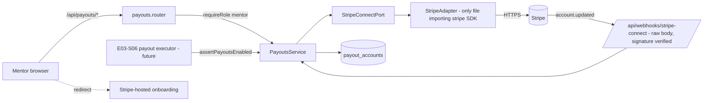

# Stripe Connect onboarding — a mentor completes onboarding and sees whether payouts are enabled

Source: story E02-S05 (#24) with its task E02-S05-T01 (#39, Stripe Connect integration), epic E02 (#12) · Design authority: `.ai/specs/product-brief.md` (R05, D04, D13, D19, Q19, glossary "Connect onboarding") · Builds on: `.ai/specs/2026-10-18-auth-and-roles.md` (spec PR #46, not yet merged) · Sibling (not covered here): the E02 "mentors become bookable" spec for E02-S01…S04 (#20–#23)

## 📝 TLDR

A mentor has no way to be paid today: DevMentor has no accounts, no Stripe code and no payout state. This spec proposes (future behavior) the mentor side of Stripe Connect: a mentor opens one screen, is sent to Stripe-hosted onboarding, comes back, and sees either "payouts enabled" or the exact step still missing. The integration (#39) is a `StripeConnectPort` with one vendor adapter, a verified Connect webhook and a stored status snapshot; the story (#24) is the screen and API on top of it. One spec covers both because the task is the story's only technical content; they ship as two phases, task first. **The spec decides no payout itself** — it only guarantees that nothing can ask "may this mentor be paid?" and get yes before onboarding is complete (R05); executing payouts is E03-S06 (#30).

> **Iteration.** E02-S05 and its task are **1.1 (D13)** — outside the first iteration (the 14 stories D13 lists). Nothing in this spec is a prerequisite of the first-iteration ship on 2026-10-31. The brief's Q19 (how mentors are paid for first-iteration sessions before Connect exists) is **open and not answered here**; see Risks.

## 📝 Problem Statement

R05/D04: Stripe is the only provider, Connect carries payouts, and a mentor must complete Connect onboarding before the first payout. The brief defines the term ("the Stripe Connect setup a mentor completes before their first payout") and the three acceptance criteria of #24 — status reads *payouts enabled* after onboarding, the missing step is shown while unfinished, no payout without completed onboarding — but no screen, state or integration exists. The brief's evidence for the problem is thin (one mentor interview: the mentor answers questions unpaid); this spec carries no claim about how many mentors will complete onboarding or how long it takes.

Naming note: the brief and D04 call this onboarding "E02-S06"; the tracker files it as **E02-S05 (#24)**. The tracker is the authority; this spec uses #24.

## 📝 Proposed Solution

- **Hosted onboarding.** Stripe collects identity and bank details on its own pages (Account Links, `account_onboarding`). DevMentor never sees or stores personal or bank data.
- **Account type.** A connected account created through the Accounts API **with controller properties** (Stripe-hosted onboarding, Stripe-collected requirements, platform pays fees/bears losses, `transfers` capability only — a mentor is a payee, not a merchant), recipient service agreement so mentors outside the platform's country can be paid. Stripe's documentation marks the named `express` type as legacy for new platforms and steers new builds to controller properties / Accounts v2; the exact parameter set is **verified against current Stripe docs in Phase 1 step 1** and pinned in one constant (see Resolved assumptions SQ2).
- **One row per mentor.** `payout_accounts` holds the mentor's Stripe account id and a **snapshot** of its status (`details_submitted`, `payouts_enabled`, `transfers_active`, requirements due, disabled reason). Stripe is the source of truth; the snapshot is refreshed by the Connect webhook and by an explicit refresh when the mentor returns from Stripe. Every refresh **re-retrieves the account from Stripe** instead of trusting an event payload, so duplicate and out-of-order webhooks cannot move state backwards.
- **One derived status**, computed in one pure helper: `not_started` · `onboarding_incomplete` (with the list of missing steps) · `under_review` (everything submitted, Stripe has not enabled payouts yet) · `restricted` (was or is disabled by Stripe, with reason) · `payouts_enabled`.
- **Eligibility port for later work.** `PayoutEligibility.assertPayoutsEnabled(mentorUserId, { refresh })` throws unless the status is `payouts_enabled`. E03-S06 must call it (with `refresh: true`) before moving money. This is how "no completed onboarding → no payout" (#24 AC3) is enforced at its source.
- **Ports and adapters.** `StripeConnectPort` in `*.model.ts`; **one** adapter file imports the `stripe` SDK. The same file also implements the Checkout port of E03-S03-T01 (#38) — see Architecture. Secrets only via environment; webhook signatures verified before any parsing.
- **Alternatives considered.** (1) Mentor pastes bank details into a DevMentor form — rejected: puts KYC/bank data and PCI-adjacent liability on us. (2) Manual transfers by the founders (D19 hand-work) — not an alternative to this story but Q19's open option; a manual channel would be a second payout channel against R05 and is out of scope. (3) Trust webhook payloads and keep no refresh — rejected: out-of-order delivery. (4) Poll Stripe on a schedule instead of webhooks — rejected as the primary path: no scheduler exists; refresh-on-return plus webhook covers it.

## 📝 Architecture

Existing: Express app in `apps/shell/src/server.ts` (routers mounted by hand; body parsing is per router), `apiErrorHandler`, typed `AppError` hierarchy, MikroORM `EntitySchema` + `createOrm`, `REQUEST_CONTEXT`/`ServerRequestContext`, `TasksApi` Server/Http pair. **Planned by the auth spec (not merged):** `users`, `sessions`, `requireSession`/`requireRole`, the CSRF-header client request helper, validated startup config including `APP_BASE_URL`, the `/mentor` placeholder home. **New here (all planned):** concept folder `payouts` in each layer — `server/payouts/`, `core/api/payouts.model.ts` + `PayoutsApi`, `store/payouts/`, `features/payouts/`.

Takeaway: the mentor's browser only ever talks to our API and to Stripe's hosted pages; all Stripe API calls and the webhook go through one port, and the only consumer of "may this mentor be paid" is a single guard function.

**Shared adapter with #38.** #39 depends on E03-S03-T01 (#38), the Checkout integration, which is a first-iteration story and will normally be implemented first. The standard allows a vendor SDK in exactly one adapter file, so Checkout and Connect are **two ports implemented by one adapter file** `server/payments/stripe.adapter.ts` (a `payments` folder shared by both specs' implementations). Whichever PR lands first creates the file, the `stripe` dependency, the pinned API version constant and the `STRIPE_SECRET_KEY` config; the other extends it. This spec does not define the Checkout port.

**Webhook mounting.** `POST /api/webhooks/stripe-connect` is mounted with `express.raw({ type: 'application/json' })` **before** any JSON parser and outside the session/CSRF layer (it authenticates by Stripe's signature, not a cookie). Connect events need their **own endpoint and signing secret**: a Connect listener receives events about connected accounts, a platform listener (Checkout, #38) does not. A route that already exists for #38 is a different path with a different secret.

Dependencies on other work:
- E01-S01/S03 (auth spec Phases 1 and 3): users, sessions, `requireRole`, CSRF header. **Backlog correction:** #24 lists only E01-S01 (#17) as a dependency, but this story needs the *role guard* (E01-S03, #19) and a mentor to exist (E02-S01, #20, sibling spec). Until #20 lands no real mentor can exist; tests use fixtures (the auth spec's Q12 stance).
- #38: shared adapter, config, dependency (above).
- E03-S06 (#30) consumes `PayoutEligibility`; it is not part of this spec.

## 📝 Data Model

`payout_accounts` (`EntitySchema` `PayoutAccount` in `server/payouts/payout-account.entity.ts`, record type in `payout-account.model.ts`):

| column | type | notes |
| --- | --- | --- |
| `id` | uuid PK | generated server-side |
| `user_id` | uuid not null, **unique**, FK → `users` on delete restrict | the mentor; one account per mentor |
| `stripe_account_id` | varchar(64) null, **unique** | null until Stripe confirmed creation (see Edge Cases) |
| `details_submitted` | boolean not null default false | |
| `payouts_enabled` | boolean not null default false | |
| `transfers_active` | boolean not null default false | `capabilities.transfers === 'active'` |
| `requirements_due` | jsonb not null default `[]` | Stripe requirement keys (`currently_due` + `past_due`), no values |
| `disabled_reason` | varchar(64) null | Stripe's `requirements.disabled_reason` |
| `synced_at` | timestamptz null | when the snapshot's Stripe read started |
| `created_at` | timestamptz not null | |

Derived, never stored: `PayoutStatus`. Payouts count as enabled only when `payouts_enabled AND transfers_active AND disabled_reason IS NULL`.

Sensitive data: no personal, identity or bank data is stored — Stripe holds it. The Stripe account id is internal: **not** sent to the browser, `TransferState` or logs (the client payload is `{ status, missingSteps, payoutsEnabled }`). Account Link URLs grant access to the mentor's personal data: never stored, never logged, returned once in the response of the authenticated request.

Schema is additive (one table), bootstrap stays `schema.update()` per the standard. The implementing PR updates `BACKWARD_COMPATIBILITY.md` §1–2 (routes, table) and §4 (new variables). **New required variables are a breaking change for every existing deployment:** the implementing PR documents them in the README and the rollout note (the app refuses to start without them, same as the auth spec's variables).

## 📝 API Contracts

Mentor routes under `/api/payouts`, JSON, errors in the shared envelope `{ message, code?, fieldErrors? }`. Every route calls `requireRole('mentor')` first and resolves the account **from the session user id only** — no request carries a user id, account id or URL (record-level authorization by construction; there is no other mentor's id to enumerate). State-changing routes require the CSRF header from the auth spec.

| Route | Request | Success | Failure |
| --- | --- | --- | --- |
| `GET /api/payouts/account` | — | `200` `{ status, payoutsEnabled, missingSteps: [{ code, label }] }` from the stored snapshot; `not_started` when no row | `401`/`403` per auth |
| `POST /api/payouts/account/refresh` | — | `200` same body after re-retrieving from Stripe and updating the snapshot | `502` `code: payments_unavailable` when Stripe fails — stored snapshot unchanged |
| `POST /api/payouts/onboarding-link` | — | `200` `{ url }` — a fresh single-use Account Link; creates the Stripe account first when the mentor has none | `502` `payments_unavailable`; `409` `code: already_enabled` is **not** used — a mentor may reopen Stripe to update details, the link is allowed |
| `POST /api/webhooks/stripe-connect` | raw body + `Stripe-Signature` | `200` empty body after processing (also for duplicates, unknown events and unknown accounts) | `400` bad/missing signature (nothing parsed, nothing changed); `500` on a transient internal failure so Stripe retries |

`return_url` = `${APP_BASE_URL}/mentor/payouts?stripe=return`, `refresh_url` = `${APP_BASE_URL}/mentor/payouts?stripe=refresh` — fixed server-side constants, never taken from the request (no open redirect). Stripe passes no status on return; the page reacts to `?stripe=return` by calling `refresh`, and to `?stripe=refresh` (expired/used link) by requesting a new link.

`missingSteps` is built from `requirements_due` through a typed map of known Stripe requirement keys to labels (for example `external_account` → "Add a bank account for payouts", `individual.verification.document` → "Verify your identity", `tos_acceptance.*` → "Accept Stripe's terms"); any key not in the map renders the generic "Stripe needs more information — continue onboarding", so a new Stripe key never breaks the screen or leaks a raw key. The map lives in configuration (`payouts.model.ts`), not in conditionals.

Mentor-facing rate limit: onboarding-link and refresh share an in-process limiter, 10 calls per mentor per hour, `429` beyond (protects the Stripe API quota; lost on restart, as in the auth spec).

Config (validated at startup, `.env` git-ignored; names shared with #38 marked †): `STRIPE_SECRET_KEY` †, `STRIPE_CONNECT_WEBHOOK_SECRET`, `APP_BASE_URL` (auth spec), optional `STRIPE_API_BASE_URL` (integration tests point the SDK at a local fake; refused when the key is `sk_live_…`). A live key outside `NODE_ENV=production`, or a test key in production, fails startup. The Stripe API version is a pinned constant in the adapter, not an environment variable.

## 📝 UI/UX

Flows only; no mockups (no test-environment descriptor exists, so this spec is text-only).

- **`/mentor/payouts`** (mentor-only, behind the auth spec's role guard; linked from the `/mentor` home). One status card, one primary action, `data-testid` on card and button.
  - `not_started`: "Set up payouts" — explains in one line that Stripe collects identity and bank details and DevMentor never sees them; button "Set up payouts with Stripe" → `onboarding-link` → browser navigates to Stripe.
  - `onboarding_incomplete`: lists each missing step; button "Continue setup on Stripe".
  - `under_review`: "Stripe is reviewing your details" — no action beyond "Check again" (refresh).
  - `restricted`: "Payouts are paused by Stripe" + button "Fix on Stripe"; shows the human label for the reason.
  - `payouts_enabled`: "Payouts enabled" with a quiet "Update details on Stripe" link.
  - Return from Stripe: spinner state while `refresh` runs, then the card. Stripe/network failure: banner "We could not reach Stripe. Try again." — the card keeps the last known status and marks it as possibly out of date.
- The primary action opens Stripe by full-page navigation to the returned `url` (SSR-safe: performed in an injected browser abstraction, not `window` in the component).
- Accessibility: the status is text, not colour alone; the status card is a live region so the post-return update is announced; the button has a visible label and a busy state.
- Copy never promises when money arrives and states no fee or share (E03-S06 owns that). The product direction on payout timing is not decided here.

## 📝 Edge Cases & Failure Scenarios

- **Stripe error leaves mentor state consistent (#39 AC).** Account creation is a claim-then-call sequence, never a DB transaction held across a network call: (1) upsert the row for the mentor with `stripe_account_id = null` — the unique `user_id` makes concurrent clicks collapse to one row; (2) create the Stripe account with an **idempotency key** derived from the mentor's user id and `metadata.devmentor_user_id`; (3) set `stripe_account_id`. If (2) fails: the row stays `not_started`, retry is safe. If (3) fails after (2) succeeded: a retry within Stripe's idempotency window returns the same account; later, the first `account.updated` for an account unknown to us is linked to the row through `metadata.devmentor_user_id`. A Stripe failure while refreshing or creating a link never writes the snapshot.
- **Webhook signature missing, malformed or wrong, or timestamp outside Stripe's tolerance:** `400`, nothing parsed, nothing written, logged without the header or body. Verification uses the raw bytes (a re-serialized JSON body fails verification — hence `express.raw`).
- **Duplicate and out-of-order webhooks:** every `account.updated` triggers a fresh retrieve and a conditional update (`where synced_at is null or synced_at < :readStartedAt`), so an older read can never overwrite a newer one. Replays are harmless.
- **Event for an account we do not know and without our metadata:** `200`, logged as ignored (another Connect user of the same Stripe account, or test data). Unrelated event types: `200`, ignored.
- **Mentor returns from Stripe without finishing:** `refresh` shows `onboarding_incomplete` with the real missing steps (#24 AC2). Expired or reused Account Link → Stripe redirects to `refresh_url`; the page requests a new link automatically once, then shows the button.
- **Payouts later disabled by Stripe** (verification failed, new requirement): the next webhook flips the snapshot to `restricted`; `assertPayoutsEnabled` fails from that moment; the mentor sees why.
- **Two tabs, two links:** each request returns its own link; both are valid until used; state converges on the next refresh.
- **Role change:** if a mentor loses the `mentor` role (auth spec: role read from DB on every request), the routes deny immediately; the `payout_accounts` row is kept, and eligibility checks fail closed because the executor also requires the mentor role (E03-S06 concern, noted there).
- **Stripe unreachable at startup:** not checked at startup (no network dependency to boot); first use returns `502`.
- Observability: structured events for account created, status transition (old → new, user id), webhook rejected, webhook ignored, Stripe call failed (operation + Stripe error code) — never keys, signatures, Account Link URLs, account ids in client payloads, or request bodies.

## 📝 Risks & Impact Review

- **Q19 is open and this spec does not close it (founders A and B).** D13 puts #24 and #30 in 1.1, so a first-iteration session is paid for (E03-S03) while the mentor cannot yet be paid through Connect. Whether the founders then pay by hand (a second payout channel against R05) or hold the money until 1.1 is theirs to decide. **One constraint this spec can state:** holding is only possible without a second channel if Checkout (#38) charges settle on the **platform** balance — i.e. *separate charges and transfers* rather than destination charges that need a connected account at payment time. Recommended to #38/E03-S06; flagged for confirmation (SQ6). Nothing here builds a manual channel.
- **Hard to reverse:** the connected-account configuration (controller properties, service agreement, `transfers`-only capability) is fixed at creation per account; changing it later means re-onboarding every mentor. Hence the verification step in Phase 1 and the ⚠ on SQ2.
- **Country coverage (D04's revisit trigger).** Stripe creates accounts in the platform's country by default and can onboard other countries only when country-based onboarding is enabled in the Connect settings; cross-border payees get restricted capabilities. If a mentor's country is not served, D04 reopens (founder A). Mentors' countries are unknown to this spec (D24 names the beachhead by language and stack, not country).
- **Platform liability:** with platform-bears-losses controller settings DevMentor is liable for connected-account losses; Stripe requires fraud screening. Acceptable for invite-only mentors (R07); revisit if invitations open.
- **Money and auth are risk-high (SDLC):** implementing PRs apply the security checklist in `.ai/docs/engineering-standards.md`, and every negative acceptance criterion gets a regression test.
- **New dependency:** `stripe` (JS SDK) — shared with #38, version and API version pinned.
- **Human prerequisites outside the repo:** a Stripe account with Connect enabled and a completed platform profile, Connect branding, country-based onboarding setting, a Connect webhook endpoint pointed at `/api/webhooks/stripe-connect` subscribed to `account.updated`, and the secrets supplied to each environment. Phase 2 cannot be verified end to end without them.
- **Webhook reliability:** a missed webhook is repaired by the refresh on return and by E03-S06's `refresh: true` check; there is no background reconciliation job in this spec (no scheduler exists).
- Not evidenced: that mentors will tolerate the onboarding friction, or how long it takes (one interview). No metric is claimed.

## 📝 Decisions in play

- R05 / D04 — Stripe only; Connect for payouts; onboarding before the first payout (founder A) — implemented here, with the country caveat above.
- D13 — E02-S05 and its task are **1.1**, not first iteration; nothing superseded.
- D19 — the operator is the two founders; there is no operator view of mentors' payout status in this spec (E05 stories, 1.1). Until then founders read status in the Stripe Dashboard and act by hand, logged in the shared note.
- R07 / D08 — mentors only by invitation: this spec adds no path to the mentor role.
- Q19 — open, carried (see Risks).
- Auth spec (#46): relies on it as written; changes none of its contracts. If it changes before merge, Phase 2's guard and config steps follow.

## Resolved assumptions (autonomous defaults)

| # | Question | Chosen answer | Rationale |
| --- | --- | --- | --- |
| SQ1 | One spec or two (story + task)? | One spec, two phases (task first) | The task is the story's only technical content; neither ships alone. |
| SQ2 | Connected-account type | Accounts API with controller properties (hosted onboarding, Stripe-collected requirements, platform pays fees/bears losses), `transfers` capability only, recipient service agreement; parameters verified against current Stripe docs in Phase 1 step 1 ⚠ NEEDS HUMAN CONFIRMATION | Stripe marks named Express accounts legacy for new platforms. Fixed per account at creation, so a wrong choice costs re-onboarding every mentor; liability (platform bears losses) is a founder call. |
| SQ3 | Who holds identity and bank data? | Stripe only; DevMentor stores status flags, never PII/bank data | Smallest compliance surface. |
| SQ4 | Source of truth for status | Stripe; stored snapshot refreshed by Connect webhook and refresh-on-return, each re-retrieving the account | Idempotent and order-safe without an event table. |
| SQ5 | Payout guard shape | `assertPayoutsEnabled(mentorUserId, { refresh })` throwing unless `payouts_enabled ∧ transfers_active ∧ no disabled_reason` | One enforcement point for #24 AC3; E03-S06 owns the actual payout. |
| SQ6 | Q19 / charge model | This spec does not answer Q19; recommends separate charges and transfers for #38 so held funds can be transferred later ⚠ NEEDS HUMAN CONFIRMATION (founders A and B) | Product decision on first-iteration payouts is the founders'; the recommendation avoids a second payout channel. |
| SQ7 | Country handling | No country sent at account creation; Stripe's default (platform country) plus country-based onboarding enabled in Dashboard; mentors' countries to be confirmed ⚠ NEEDS HUMAN CONFIRMATION | Country is immutable per account; D04 names an unserved country as a reopen trigger; no data on mentors' countries. |
| SQ8 | Webhook endpoint | Separate Connect endpoint `/api/webhooks/stripe-connect` with its own secret | Connect events and platform events use different listeners and secrets. |
| SQ9 | Mentor operator visibility | None in this spec | Operator screens are E05 (1.1); D19 hand-work until then. |
| SQ10 | Mentor country-of-service, KYC prompts, payout schedule UI | Not built; Stripe hosted pages and Express-style dashboard link cover them | Smallest scope for "sees whether payouts are enabled". |
| SQ11 | Rate limiting | In-process 10/hour per mentor on link and refresh | No new infrastructure; protects Stripe quota. |
| SQ12 | Where does the mentor's status screen live? | `/mentor/payouts`, linked from the auth spec's `/mentor` home | Smallest surface; fits the role-home model. |

## 📋 Phasing

- **Phase 1 — E02-S05-T01 (#39): Stripe Connect integration.** Port and adapter, config, schema, snapshot sync service, verified webhook, `PayoutEligibility`. No UI. Starts only after #38's adapter exists or creates it.
- **Phase 2 — E02-S05 (#24): mentor onboarding screen.** Mentor routes, client API/store, `/mentor/payouts`, integration and e2e. Needs the auth spec's Phase 3 (role guard) and a mentor fixture; ships in 1.1 (D13).

Each phase leaves the app deployable. Phase 2 adds routes and a screen only.

## 📋 Implementation Plan

Every step ships unit tests (project stays at 100% coverage); every new route/page gets an integration and an e2e happy path (AGENTS.md).

### Phase 1 — E02-S05-T01 (#39)

1. **Verify Stripe parameters, then contracts.** Confirm against current Stripe docs the account-creation parameter set (SQ2), the Account Link parameters and the `account.updated` fields; record the result in the PR. Add `core/api/payouts.model.ts` (`PayoutStatus`, `PayoutsView`, requirement-label map, limits), `server/payouts/payout-account.model.ts`, `StripeConnectPort` (`createAccount`, `retrieveAccount`, `createOnboardingLink`, `parseWebhook`) and `PayoutEligibility` in `*.model.ts`. Test: label map fallback, status derivation helper `deriveStatus` for every state including `restricted`.
2. **Config.** Extend the auth spec's startup config helper with `STRIPE_SECRET_KEY`, `STRIPE_CONNECT_WEBHOOK_SECRET`, `STRIPE_API_BASE_URL`, key-mode vs `NODE_ENV` check. Test: missing, live-in-dev, test-in-prod, fake-base-URL-with-live-key.
3. **Adapter.** `server/payments/stripe.adapter.ts` (create it, or extend #38's): the only file importing `stripe`; pinned API version; maps SDK results to port types; maps every Stripe failure to a port-level `PaymentProviderError` (no Stripe message leaks); `parseWebhook` uses `webhooks.constructEvent` on the raw bytes and throws `InvalidSignatureError`. Add `UpstreamError` (→ `502`) to `server/http/errors.ts`. Test: adapter with a mocked SDK client — success, card/invalid-request error, network error, bad signature, replayed old timestamp.
4. **Entity and repository.** `PayoutAccount` schema (unique `user_id`, unique `stripe_account_id`), registered in `createOrm`; `PayoutAccountsRepository` (fork `EntityManager` per call, claim-row upsert, conditional snapshot update by `synced_at`, link-by-metadata). Test: repository specs incl. concurrent claim and stale-read-does-not-overwrite.
5. **`PayoutsService`.** `getAccount`, `startOnboarding` (claim → create → link with the idempotency key), `refresh`, `applyAccountUpdated(accountId)` (retrieve → conditional update; unknown account → link via metadata or ignore), `assertPayoutsEnabled`. Test: every Edge Case row — Stripe failure before/after create leaves state consistent, restricted account blocks, `refresh: true` re-reads.
6. **Webhook route.** `webhooks.router.ts`: `express.raw`, signature → service, `200`/`400`/`500` mapping, mounted before JSON parsers behind the `schemaReady` gate; log events per Observability. Test: valid, invalid and missing signature, duplicate, unknown type, unknown account, internal failure → `500`.
7. **Integration.** Fake Stripe server via `STRIPE_API_BASE_URL`; test signs a webhook with the test secret; asserts a signed `account.updated` flips the stored status and an unsigned one does not. Update `BACKWARD_COMPATIBILITY.md` (§1 route, §2 table, §4 variables) and the README rollout note.

### Phase 2 — E02-S05 (#24)

1. **Mentor routes.** `payouts.router.ts` (`createPayoutsRouter`), `requireRole('mentor')` first, no identifiers in requests, CSRF header, limiter, view mapping through `deriveStatus` + label map; expose the service through `ServerRequestContext`. Acceptance mapping: AC1 → refresh after a `payouts_enabled` account reads `payouts_enabled`; AC2 (negative) → incomplete account returns the missing steps; AC3 (negative) → `assertPayoutsEnabled` rejects every non-enabled status. Test: router specs per branch; mentee and signed-out denied; one mentor cannot see another's status.
2. **Client plumbing.** `PayoutsApi` abstraction with `ServerPayoutsApi` (session cookie via `REQUEST_CONTEXT`, `TransferState`) and `HttpPayoutsApi`; `store/payouts/` slice (actions, reducer, selectors, effects). Test: API, effects (including the Stripe-failure path keeping the last status), reducer, selectors.
3. **Screen.** `features/payouts/` page with view-model service, all five states plus failure/loading, return handling for `?stripe=return|refresh`, navigation to Stripe through an injected abstraction; route `/mentor/payouts` behind the mentor guard and a link from the `/mentor` home. Test: component and view-model specs.
4. **Integration + e2e.** Mentor signs in (fixture), opens the screen, starts onboarding (fake Stripe returns a link), returns, sees missing steps, then an enabled `account.updated` shows "Payouts enabled". Negative: mentee gets `403`.
5. **Close-out.** Move this spec to `.ai/specs/implemented/` when both phases ship; amend the Q19 note if the founders decide it.
